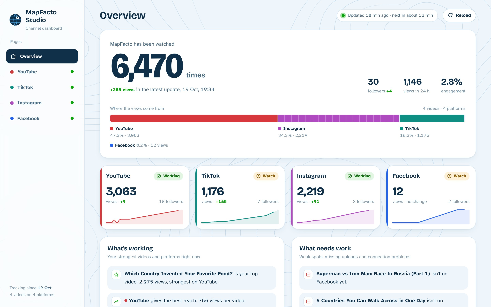

# MapFacto Studio



**Live dashboard: https://akshay-allam.github.io/mapfacto-studio/**

A live dashboard for the MapFacto channel on **YouTube, TikTok, Instagram and Facebook**.
It runs 24/7 on GitHub for free, so your computer can be off.

- **The website** (`docs/`) is hosted on GitHub Pages.
- **The robot** (`.github/workflows/update.yml`) runs every 30 minutes on GitHub Actions. It pulls fresh numbers and saves the history in `data/`.
- **Your API keys** are stored as encrypted GitHub *secrets*. They're never in the code, never in the website and never printed in logs.

```
GitHub Actions (every 30 min)          GitHub Pages
  pipeline/run.py ──► data/*.csv  ──►   docs/index.html  ◄── you, on any device
    YouTube API      (history)          docs/data.json
    Instagram API
    Facebook API
    TikTok (yt-dlp)
```

## Set it up (about 15 minutes, all in a browser)

### 1. Create the repository
1. Go to https://github.com/new
2. Name: `mapfacto-studio`. Choose **Public**, because GitHub Pages is free only for public repos (your keys stay secret either way).
3. Click **Create repository**.

### 2. Upload the files
1. On the new repo page, click **uploading an existing file**.
2. Unzip `mapfacto-studio.zip` on your computer, open the folder, select **everything inside it** (including the `.github` folder), and drag it into the page.
   - Can't see `.github`? On Windows, in File Explorer go to **View → Show → Hidden items**.
3. Click **Commit changes**.

### 3. Add your keys as secrets
Repo → **Settings → Secrets and variables → Actions → New repository secret**. Add each one; the values are the same as in your `.env` file:

| Name | Value |
|---|---|
| `YT_API_KEY` | your YouTube API key |
| `IG_TOKEN` | your Instagram token |
| `FB_PAGE_TOKEN` | your Facebook Page token |
| `FB_PAGE_ID` | `1420281564498616` |

TikTok needs no key.

### 4. Allow the robot to save data
Repo → **Settings → Actions → General → Workflow permissions** → choose **Read and write permissions** → **Save**.

### 5. Turn on the website
Repo → **Settings → Pages** → **Source: Deploy from a branch** → Branch **main**, folder **/docs** → **Save**.
After about a minute the page shows your link: `https://<your-username>.github.io/mapfacto-studio/`

### 6. Run the first update
Repo → **Actions** tab → if asked, click **I understand my workflows, go ahead and enable them** →
**Update MapFacto stats** → **Run workflow**. A green tick means it worked. From then on it runs every 30 minutes by itself.

Open your link and add it to your phone's home screen (in your phone's browser: Share → *Add to Home Screen*).

## Good to know
- **Where to see problems:** the **Connections** panel on the Overview page shows each platform's last update and any error. For full details: **Actions** tab → the latest run → *Pull the latest numbers*.
- **Instagram token** lasts 60 days. When Instagram shows a problem, make a new token (same steps as before) and paste it into the `IG_TOKEN` secret.
- **TikTok** sometimes blocks GitHub's servers. If it does, TikTok shows "Problem" and keeps its last numbers. The other platforms aren't affected.
- **Data is public.** The repo, and so the view counts in `data/`, can be seen by anyone with the link. Your keys can't.
- **If updates stop**, GitHub sometimes pauses scheduled robots. The dashboard then shows an orange dot and "the automatic update may be paused". Go to **Actions → Update MapFacto stats → Enable workflow**.
- **Optional, YouTube retention:** add `YT_CLIENT_ID`, `YT_CLIENT_SECRET` and `YT_REFRESH_TOKEN` as secrets (YouTube Analytics API, read-only scope).

## Run it on your PC (optional)
```
pip install -r requirements.txt
python pipeline/run.py          # pull + rebuild (uses your .env)
python -m http.server -d docs   # then open http://localhost:8000
```

## Files
| Path | What it is |
|---|---|
| `docs/index.html`, `app.js`, `styles.css` | the website |
| `docs/data.json` | numbers the website shows (rebuilt by the robot) |
| `docs/vendor/`, `docs/fonts/` | chart library (ECharts, Apache-2.0) and fonts (SIL OFL) |
| `pipeline/collect.py` | talks to each platform |
| `pipeline/build.py` | computes totals, verdicts, insights and charts |
| `pipeline/run.py` | one update: load history → pull → save → build |
| `data/*.csv` | the full history (only rows where something changed) |
